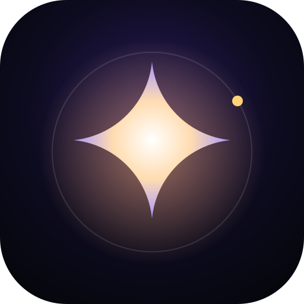
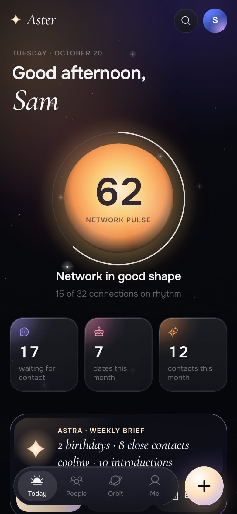
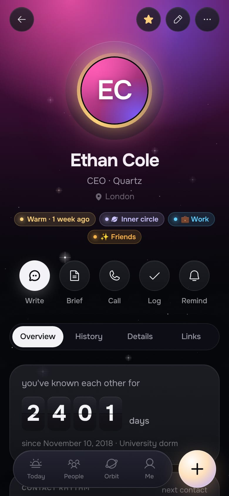
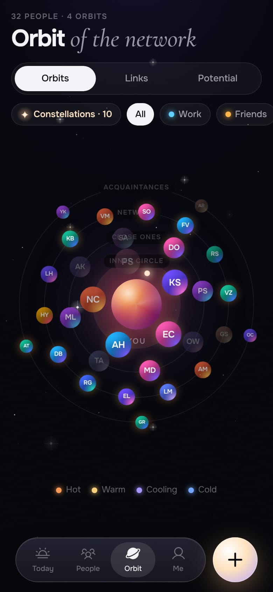

<div align="center">



# Aster

**A personal CRM for people you care about.**<br/>
Remember everyone: how you met, what matters to them, and when it is time to reach out.

[](https://github.com/maxbzd/Aster/actions/workflows/ci.yml)
[](LICENSE)
[](#privacy-and-your-data)
[](docs/I18N.md)

[English](README.md) · [Русский](README.ru.md)

**[▶ Open the app](https://maxbzd.github.io/Aster/)**: runs in your browser, nothing to install

 &nbsp;  &nbsp; 

</div>

Aster is a dark, fast, installable web app (PWA) for keeping up with the people in your life and work: friends, family,
colleagues, mentors, investors, clients. It works fully offline, keeps all data on your device, needs no account and no
server, and ships with an optional AI assistant, **Astra**, that can run entirely on your device.

It is free and open source (MIT). You can use it as-is, host your own copy, or fork it.

## Highlights

- **Local-first.** Everything lives in IndexedDB on your device. No sign-up, no tracking, no server required. Works offline.
- **Today.** Who is due for a message, birthdays and anniversaries, reminders, the "person of the day" and a pulse of your network.
- **People.** Rich profiles: how you met, facts, family, what they look for and how you can help each other, gift ideas, topics to bring up, a full timeline.
- **Orbit.** Your network as a star system: four orbits of closeness, brightness shows how warm each connection is.
- **Reserve.** A shelf for strong contacts you do not have a relationship with yet. Import hundreds from Excel, CSV, vCard or pasted text and find them later by meaning.
- **Astra, the assistant.** Dictate or type a note after a meeting and get a clear plan of what to save. Pre-meeting briefs, "ask your network", message drafts in three tones, introductions between people who should meet.
  Astra has a built-in on-device brain and can optionally use a cloud model of your choice.
- **Hands-free voice.** "Astra, note that Nina and I agreed on Friday." Astra shows the plan and saves only after you confirm.
- **Yours to move.** Backups, vCard import/export, `.ics` calendar export, CSV export.
- **English and Russian**, including the on-device assistant, which understands both languages. [Add your own language](docs/I18N.md).
- **Optional cloud sync** across devices through your own Supabase project, plus an **MCP server** so Claude can read and write your data, TickTick sync, and a bridge to the companion app Orbita.

## Quick start

Requirements: Node.js 22 or newer.

```bash
git clone https://github.com/maxbzd/Aster.git
cd Aster
npm install
npm run dev          # http://127.0.0.1:5191
```

Choose **See an example** on the last onboarding step to explore a fictional network, or start empty.

```bash
npm run build        # production build in dist/ (with a service worker for offline use)
npm run preview      # serve the production build locally
npm run check        # typecheck + lint + i18n check + tests + build + size budget
```

### Install on your phone

A PWA can be installed only from an HTTPS address, so host the `dist/` folder on any static host
(Cloudflare Workers/Pages, Vercel, Netlify, GitHub Pages). A step-by-step guide is in [docs/DEPLOY.md](docs/DEPLOY.md).

- **iPhone:** Safari, then Share, then "Add to Home Screen".
- **Android:** Chrome, then the menu, then "Install app".

Your data lives on the device you use. Move it between devices with **Profile, Backup / Restore**, or turn on
[cloud sync](docs/CLOUD.md).

## Astra: the assistant

Astra has two brains. The **basic brain** runs on your device, is free and sends nothing anywhere. A **cloud model**
(optional) understands meaning, reads business-card photos and writes more natural text. Every feature works in both modes.

| Feature | What it does |
|---|---|
| Capture a meeting | Speak, type or snap a business card. Astra shows "here is what I understood": people, facts, family, what someone is looking for, reminders with dates. Nothing is saved until you agree. |
| Pre-meeting brief | Who this is, what happened last time, promises on both sides, what to ask, how you can help, how to open the conversation. |
| Ask your network | `Ctrl/⌘ K`, then a plain question: "who can help with a visa to the UAE?" You get people with reasons. |
| Matchmaker | Pairs of people who should meet (who looks for what, who is strong at what), with double-opt-in intro messages. |
| Reasons to write | Birthdays, anniversaries, promises, new acquaintances, topics, each with a draft in three tones. Messages are never sent for you. |
| Event mode | Jot a few words about everyone you meet at an event, then review them in a batch in the evening. |
| Weekly brief | The week's essentials: whom to write, whom to congratulate, whom to introduce. |
| Chat | "What did I promise Oliver?", "which investors in Dubai haven't I seen for a while?" Answers come from your own notes. |

**Connecting a model.** In **Profile, Astra** choose how Astra connects:

- **Device**: the basic brain, no setup.
- **Own key**: your Anthropic API key, stored only on your device and never included in backups.
- **Proxy**: your own proxy with an access token (an example is in `api/claude/`).
- **Server** (needs the cloud): keys are kept in a Supabase Edge Function and never reach the browser. It supports Claude,
  Gemini, Groq, and **any OpenAI-compatible gateway** (OpenRouter, LiteLLM, Ollama, your company gateway). See [docs/DEPLOY.md](docs/DEPLOY.md).

## Privacy and your data

- With no cloud configured, nothing leaves your device. There is no analytics and no telemetry.
- When you use a cloud model, only what is needed for the task is sent: one person's card or a compact list of your network
  without phone numbers or emails. You can turn off sharing of notes and history. Astra produces drafts only and never sends messages.
- API keys you type stay on the device and are excluded from backups and from cloud sync.
- Self-hosters decide what to run: every server component is in this repository.

## More inside

- **Family** as separate cards with their own birthdays, outside your network rhythms.
- **Important dates and preferences**: anniversaries, food and allergies, formal or informal address, preferred channel and time; statuses such as "lost touch" or "paused" without deleting anyone.
- **Name matching** that understands transliteration and short forms (Alexey finds Алексей, Sasha finds Alexander): `src/lib/names.ts`.
- **Lists, bulk edit, duplicates**: your own lists, editing many people at once, merging duplicates with their history.
- **Connection graph and hidden potential**: clusters and "bridges" between groups, plus distant acquaintances worth reviving.
- **Year in review**, a full-screen story of your year with people.
- **Transcripts**: load an audio recording (speech-to-text on an OpenAI-compatible server, Deepgram, or your own) or a ready transcript in `.txt`, `.srt`, `.vtt` or `.json`.
- **Share into Aster** from other Android apps after installing the PWA: a link or text from Telegram, LinkedIn or Instagram opens as a new reserve contact.

## Optional integrations

Everything below needs your own Supabase project (free tier is enough). Aster does nothing online until you set it up.

| Integration | What it gives you | Guide |
|---|---|---|
| Cloud sync | The same data on all your devices; local-first, works offline | [docs/CLOUD.md](docs/CLOUD.md) |
| Server-side AI keys | Use Claude, Gemini, Groq or any OpenAI-compatible gateway without typing keys into the app | [docs/DEPLOY.md](docs/DEPLOY.md) |
| MCP server | Talk to Claude: "log a coffee with Oliver, remind me on Friday" | [docs/MCP.md](docs/MCP.md) |
| TickTick | Reminders appear in TickTick, "done" syncs both ways | [docs/TICKTICK.md](docs/TICKTICK.md) |
| Orbita bridge | Connect Aster with its companion app Orbita (tasks, commitments, journal) | [docs/BRIDGE.md](docs/BRIDGE.md) |

> **[Orbita](https://github.com/maxbzd/Orbita)** is a companion open-source project for personal tasks, commitments and reflection. The
> bridge protocol that connects the two apps lives here in `src/bridge/` and is documented in [docs/BRIDGE.md](docs/BRIDGE.md).

## Tech stack

React 19 · TypeScript · Vite · Tailwind CSS 4 · Motion · Dexie (IndexedDB) · Zustand · Phosphor Icons · vite-plugin-pwa ·
Supabase (optional) · Vitest + Testing Library · Biome.

```
src/
  app/         shell, routing, global state, quick actions
  components/  design system: glass, glows, avatars, the orb, sheets, navigation
  screens/     screens
  sheets/      bottom sheets: person, contact, reminder, circles, import
  data/        model, database, warmth logic, demo data, vCard
  lib/         date formatting, colors, .ics calendar, photos, speech
  i18n/        the translation layer and the Russian dictionary
  ai/          Astra: on-device engine, cloud client, prompts, schemas
  cloud/       optional sync with Supabase
  bridge/      optional bridge to Orbita
supabase/      migrations and Edge Functions (ai, mcp, ticktick)
api/           an example serverless proxy for Claude
tests/         unit, integration and UI tests
docs/          guides
```

## Quality

```bash
npm run check          # typecheck, lint, i18n check, tests, build, size budget
npm test               # ~1100 tests, about 40 s
npm run test:coverage
```

The tests cover pure logic (dates, warmth, `.ics`, vCard, table parsing), the data layer on a real IndexedDB
(fake-indexeddb, including migrations from old versions), the on-device Astra engine in both languages, the cloud client with
in-memory servers that follow the same rules as the SQL, the Edge Functions, and integration tests of every screen and sheet through Testing Library.
Time zone and "now" are fixed in the tests, so they do not flake. `npm run size` fails if the startup download grows beyond its budget.
CI runs everything on every push and pull request.

## Contributing

Contributions are welcome: bug reports, features, translations, docs. Read [CONTRIBUTING.md](CONTRIBUTING.md) first.
How the code is organised: [docs/ARCHITECTURE.md](docs/ARCHITECTURE.md). Adding a language takes one JSON file: see [docs/I18N.md](docs/I18N.md). Security issues: see [SECURITY.md](SECURITY.md).

## License

[MIT](LICENSE)
