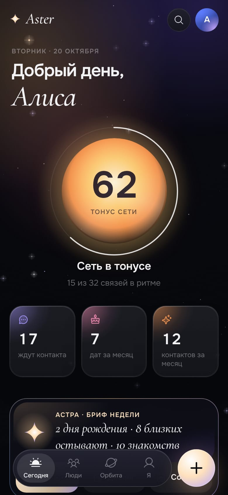
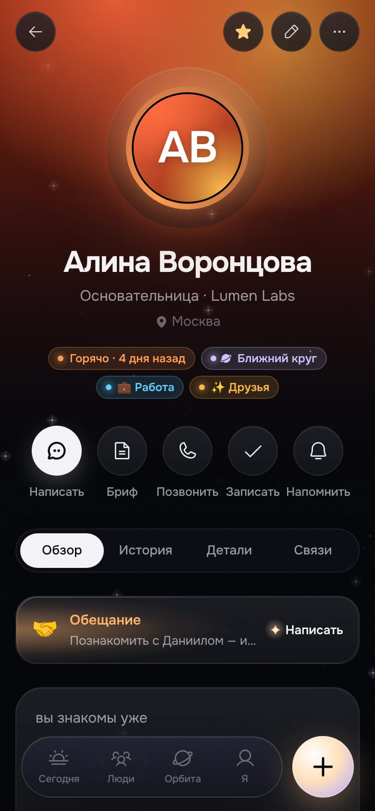
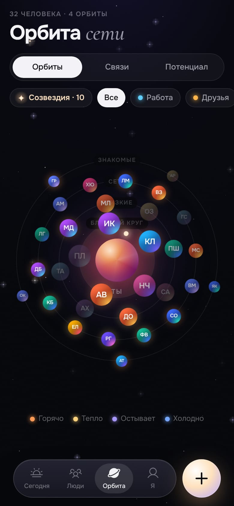

<div align="center">


# Aster

**Личная CRM для людей, которые вам дороги.**<br/>
Помнит каждого: как познакомились, что для него важно и когда пора написать.

[](https://github.com/maxbzd/Aster/actions/workflows/ci.yml)
[](LICENSE)
[](#приватность-и-ваши-данные)
[](docs/I18N.md)

[English](README.md) · [Русский](README.ru.md)

**[▶ Открыть приложение](https://maxbzd.github.io/Aster/)**: работает в браузере, ничего ставить не нужно

 &nbsp;  &nbsp; 

</div>

Aster — тёмное быстрое приложение (PWA), которое устанавливается на телефон и компьютер. Оно помогает не терять связь с людьми
в жизни и работе: друзьями, семьёй, коллегами, менторами, инвесторами, клиентами. Работает полностью офлайн, хранит данные
только на вашем устройстве, не требует ни аккаунта, ни сервера, и содержит необязательного ИИ-помощника **Астру**, который
может работать целиком на устройстве.

Проект бесплатный и с открытым кодом (MIT): пользуйтесь как есть, разверните свою копию или сделайте форк.

## Главное

- **Локально.** Всё лежит в IndexedDB на вашем устройстве. Без регистрации, слежки и серверов. Работает офлайн.
- **Сегодня.** Кому пора написать, дни рождения и годовщины, напоминания, «человек дня» и пульс сети.
- **Люди.** Подробные профили: как познакомились, факты, семья, что человек ищет и чем вы можете помочь друг другу, идеи подарков, темы для разговора, вся хронология.
- **Орбита.** Сеть как звёздная система: четыре орбиты близости, яркость показывает, насколько «тёплая» связь.
- **Резерв.** Полка для сильных контактов, с которыми пока нет отношений. Загрузка сотен людей из Excel, CSV, vCard или вставленного текста; поиск по смыслу.
- **Астра, помощник.** Наговорите или напишите заметку после встречи и получите понятный план того, что сохранить. Бриф перед встречей, «спроси сеть», черновики сообщений в трёх тонах, знакомства между людьми, которым стоит встретиться.
  У Астры есть встроенный мозг на устройстве, а при желании можно подключить облачную модель.
- **Голос без касаний.** «Астра, запиши, что с Ниной договорились на пятницу». Астра показывает план и сохраняет только после подтверждения.
- **Данные ваши.** Резервные копии, импорт и экспорт vCard, календарь `.ics`, экспорт в CSV.
- **Русский и английский** — в том числе в локальном движке Астры, который понимает оба языка. [Добавить свой язык](docs/I18N.md).
- **Необязательно:** синхронизация между устройствами через свой проект Supabase, **MCP-сервер** (Claude читает и пишет ваши данные), TickTick и мост с родственным приложением «Орбита».

## Быстрый старт

Нужен Node.js 22 или новее.

```bash
git clone https://github.com/maxbzd/Aster.git
cd Aster
npm install
npm run dev          # http://127.0.0.1:5191
```

На последнем шаге знакомства выберите **«Посмотреть пример»**, чтобы изучить вымышленную сеть, или начните с чистого листа.

```bash
npm run build        # продакшн-сборка в dist/ (с service worker для офлайна)
npm run preview      # проверить сборку локально
npm run check        # типы + линтер + i18n + тесты + сборка + бюджет размера
```

### Установка на телефон

PWA устанавливается только с HTTPS-адреса, поэтому выложите папку `dist/` на любой хостинг статики
(Cloudflare Workers/Pages, Vercel, Netlify, GitHub Pages). Пошаговое руководство — в [docs/ru/DEPLOY.md](docs/ru/DEPLOY.md).

- **iPhone:** Safari → «Поделиться» → «На экран Домой».
- **Android:** Chrome → меню → «Установить приложение».

Данные живут на устройстве. Переносить их можно через **Профиль → Резервная копия / Восстановить** или включить [синхронизацию](docs/ru/CLOUD.md).

## Астра: помощник

У Астры два мозга. **Базовый** работает на устройстве, бесплатно и ничего никуда не отправляет. **Облачная модель**
(необязательно) лучше понимает смысл, читает фото визиток и пишет живее. Все функции работают в обоих режимах.

| Функция | Что делает |
|---|---|
| Наговорить встречу | Голос, текст или фото визитки → «Вот что я поняла»: люди, факты, семья, «ищет», напоминания с датами. Пока вы не согласились, ничего не сохраняется. |
| Бриф перед встречей | Кто это, что было в прошлый раз, обещания с обеих сторон, о чём спросить, чем помочь, с чего начать. |
| Спроси сеть | `Ctrl/⌘ K` и вопрос обычным языком: «кто поможет с визой в ОАЭ?» — люди с причинами. |
| Сводник | Пары людей, которым стоит познакомиться (кто что ищет × кто в чём силён), и сообщения для двойного согласия. |
| Поводы написать | Дни рождения, годовщины, обещания, новые знакомства, темы — с черновиком в трёх тонах. Сообщения никогда не отправляются сами. |
| Режим события | Пара слов о каждом, кого встретили на мероприятии, вечером — разбор пачкой. |
| Бриф недели | Главное на неделе: кому написать, кого поздравить, кого познакомить. |
| Диалог | «Что я обещал Олегу?», «кого давно не видел из инвесторов в Дубае?» — ответы по вашим записям. |

**Подключение модели.** В **Профиль → Астра** выберите способ:

- **Устройство** — базовый мозг, ничего настраивать не нужно.
- **Свой ключ** — ваш ключ Anthropic, хранится только на устройстве и не попадает в резервные копии.
- **Прокси** — свой прокси с токеном (пример в `api/claude/`).
- **Сервер** (нужно облако) — ключи лежат в Supabase Edge Function и не попадают в браузер. Поддерживаются Claude, Gemini, Groq и
  **любой OpenAI-совместимый шлюз** (OpenRouter, LiteLLM, Ollama, корпоративный). См. [docs/ru/DEPLOY.md](docs/ru/DEPLOY.md).

## Приватность и ваши данные

- Без облака ничего не покидает устройство. Нет аналитики и телеметрии.
- С облачной моделью уходит только нужное для задачи: карточка одного человека или сжатый список сети без телефонов и почт. Передачу заметок и истории можно выключить. Астра делает только черновики и никогда не отправляет сообщения.
- Введённые ключи остаются на устройстве, не попадают в резервные копии и в синхронизацию.
- Все серверные части лежат в этом репозитории, поэтому вы сами решаете, что запускать.

## Что ещё внутри

- **Семья** — отдельные карточки со своими днями рождения, вне ритмов сети.
- **Даты, предпочтения, статусы** — годовщины; еда и аллергии; «ты/вы»; канал и время; «потеряли связь» / «пауза» без удаления.
- **Имена** — поиск с транслитом и уменьшительными (Alexey находит Алексея, Саша — Александра): `src/lib/names.ts`.
- **Списки, массовая правка, дубли** — свои списки, правка пачки людей, объединение дублей вместе с историей.
- **Граф связей и потенциал** — группы и «мосты», дальние знакомые, которых стоит вернуть.
- **Итоги года** — история на весь экран.
- **Расшифровка** — загрузка аудиозаписи (распознавание на OpenAI-совместимом сервере, Deepgram или своём) или готовой расшифровки `.txt`, `.srt`, `.vtt`, `.json`.
- **Поделиться в Aster** из других приложений Android: ссылка или текст из Telegram, LinkedIn, Instagram открывается как новый контакт резерва.

## Необязательные интеграции

Всё ниже требует собственного проекта Supabase (хватит бесплатного тарифа). Пока вы его не настроили, Aster ничего не делает в сети.

| Интеграция | Что даёт | Руководство |
|---|---|---|
| Облачная синхронизация | Те же данные на всех устройствах; локально-первая, работает офлайн | [docs/ru/CLOUD.md](docs/ru/CLOUD.md) |
| Серверные ключи ИИ | Claude, Gemini, Groq или любой OpenAI-совместимый шлюз без ввода ключей в приложении | [docs/ru/DEPLOY.md](docs/ru/DEPLOY.md) |
| MCP-сервер | Говорите с Claude: «запиши кофе с Олегом, напомни в пятницу» | [docs/ru/MCP.md](docs/ru/MCP.md) |
| TickTick | Напоминания появляются в TickTick, «выполнено» синхронизируется в обе стороны | [docs/ru/TICKTICK.md](docs/ru/TICKTICK.md) |
| Мост с «Орбитой» | Связь Aster с родственным приложением (задачи, обязательства, дневник) | [docs/ru/BRIDGE.md](docs/ru/BRIDGE.md) |

> **[Орбита](https://github.com/maxbzd/Orbita)** — родственный открытый проект для личных задач, обязательств и рефлексии. Протокол моста между приложениями лежит здесь, в `src/bridge/`.

## Стек и структура

React 19 · TypeScript · Vite · Tailwind CSS 4 · Motion · Dexie (IndexedDB) · Zustand · Phosphor Icons · vite-plugin-pwa ·
Supabase (необязательно) · Vitest + Testing Library · Biome.

```
src/
  app/         оболочка, роутинг, глобальное состояние
  components/  дизайн-система: стекло, свечения, аватары, шар, шторки, навигация
  screens/     экраны
  sheets/      шторки: человек, контакт, напоминание, круги, импорт
  data/        модель, база, логика «теплоты», демо-данные, vCard
  lib/         форматирование дат, цвета, календарь .ics, фото, речь
  i18n/        слой переводов и русский словарь
  ai/          Астра: локальный движок, облачный клиент, промпты, схемы
  cloud/       необязательная синхронизация с Supabase
  bridge/      необязательный мост с «Орбитой»
supabase/      миграции и Edge Functions (ai, mcp, ticktick)
api/           пример serverless-прокси к Claude
tests/         юнит-, интеграционные и UI-тесты
docs/          руководства
```

## Качество

```bash
npm run check          # типы, линтер, i18n, тесты, сборка, бюджет размера
npm test               # ~1100 тестов, около 40 с
npm run test:coverage
```

Тесты охватывают чистую логику (даты, «теплоту», `.ics`, vCard, разбор таблиц), слой данных на настоящем IndexedDB (включая
миграции со старых версий), локальный движок Астры на двух языках, облачный клиент с серверами в памяти по тем же правилам, что
и SQL, Edge Functions и интеграционные тесты каждого экрана и шторки через Testing Library. Часовой пояс и «сейчас» в тестах
зафиксированы, поэтому они не мигают. `npm run size` падает, если стартовая загрузка выросла выше бюджета. CI гоняет всё это на каждый push и pull request.

## Участие в проекте

Приглашаем к участию: отчёты об ошибках, идеи, переводы, документация. Сначала прочитайте [CONTRIBUTING.md](CONTRIBUTING.md).
Как устроен код: [docs/ARCHITECTURE.md](docs/ARCHITECTURE.md). Новый язык — это один JSON-файл: [docs/I18N.md](docs/I18N.md). Об уязвимостях — в [SECURITY.md](SECURITY.md).

## Лицензия

[MIT](LICENSE)
